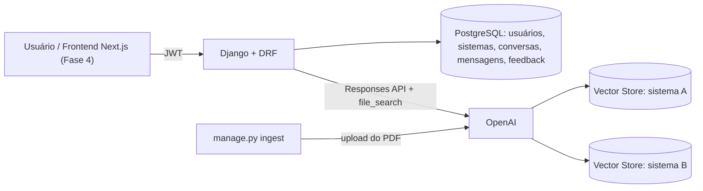

# Documentação — Chatbot de RPG com IA + RAG

API em Django + Django REST Framework para um chatbot que responde dúvidas de regras e orienta a criação de personagens de RPG de mesa, com base nos livros de regras de **2 sistemas**. A recuperação de trechos (RAG) usa o **File Search da OpenAI**.

> Contexto: projeto para um **artigo aplicado**. O objetivo é resolver o problema rapidamente com tecnologia disponível e avaliar o resultado com jogadores reais.

## Arquivos

| Arquivo | Conteúdo |
|---|---|
| [decisoes.md](decisoes.md) | Registro numerado de todas as decisões arquiteturais (inclusive as substituídas) e pendências |
| [fases.md](fases.md) | Roadmap por fases, com checklist, critério de "pronto" e status |

## Visão geral da arquitetura (MVP)

## Como manter esta documentação

1. **Nova decisão:** adicionar ao final de `decisoes.md` com o próximo número (`D26`, `D27`...).
2. **Mudou de ideia:** não apagar a decisão antiga. Criar uma nova decisão e marcar a antiga como `Substituída por Dxx`.
3. **Avanço no trabalho:** marcar os itens em `fases.md` e atualizar o status da fase.
4. **Pendência resolvida:** removê-la da lista de pendências e registrar a decisão correspondente.
